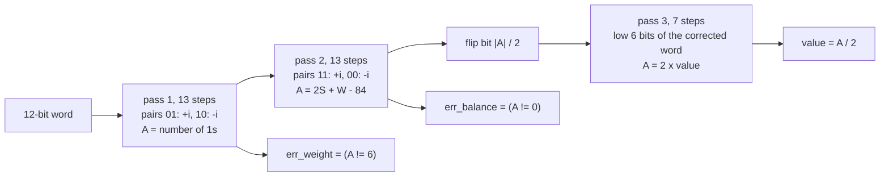

# Error-correcting decoder on a Booth-multiplier datapath

[](https://github.com/r800360/booth-ecc-sv/actions/workflows/ci.yml)
[](LICENSE)

A sequential decoder for a 12-bit constant-weight code in SystemVerilog. It corrects single errors, flags double and
triple errors, and recovers the encoded value.

It reuses the structure of a Booth multiplier: it scans bit pairs and adds or subtracts. But it accumulates bit
**indices** instead of a multiplicand, and three passes with different pair rules compute everything the code needs.
The decoder is checked on all 4096 input words against a closed-form specification, both in simulation and formally.



## The code

Ten codewords encode −5…4. Each has:
* exactly six 1s;
* bit-index sums of 39 for both its 1s and its 0s;
* its value embedded in the low six bits;
* mirror symmetry, with complementation mapping v to −(v + 1).

The minimum distance is 4. A single error in bit j moves the pass-2 result by exactly ±(2j + 1), which locates the
bit.

## Results

| Check | Result |
|---|---|
| **All 4096 input words** against the closed-form reference (Icarus and Verilator) | pass, with `done` exactly 34 cycles after start |
| Every single error (120) | flagged, corrected, value recovered |
| Every double error (660) and triple error (2 200) | flagged |
| Four-bit errors (4 950) | 190 go undetected: 40 reach another codeword, and 150 reach one of the 48 non-codewords that pass both checks |
| Formal: decoder = closed-form specification, for every word | no failure over a complete transaction (bounded model check); two broken decoders give counterexamples |
| Synthesis (Yosys, generic gates) | 65 flip-flops, 348 two-input gates, 4 inverters |

## Reproduce

Every result comes from a pinned toolchain: Ubuntu 26.04 with Icarus Verilog 12.0, Verilator 5.032 and Yosys 0.52
(see [`scripts/install-tools.sh`](scripts/install-tools.sh)).

```bash
docker build -t booth-ecc-sv .
docker run --rm -u "$(id -u):$(id -g)" -v "$PWD":/work booth-ecc-sv make ci   # everything, ~1 minute
```

`build/SUMMARY.md` collects every result. The targets are `lint`, `sim`, `formal` and `synth`.
* The *CI* workflow runs `make ci` on every push and uploads `build/`.
* *Full verification* runs the same on demand or for a `v*` tag, and a tag also publishes a release.

## Repository map

```
rtl/ecc12_decoder.sv   the decoder
tb/tb_ecc12.sv         self-checking testbench (all words, every error class), tb_common.svh
formal/                specification harness, bmc.sh, pdr.sh, run_formal.sh (expected outcomes)
docs/                  DESIGN.md (the code and the three passes), VERIFICATION.md (every check, tool invocations)
```

Origin: this design began as an assignment in a university digital-design course. This repository is an independent
SystemVerilog re-implementation, with exhaustive and formal verification of the code's guarantees.

MIT License, © 2026 Rohan Sachdeva.
